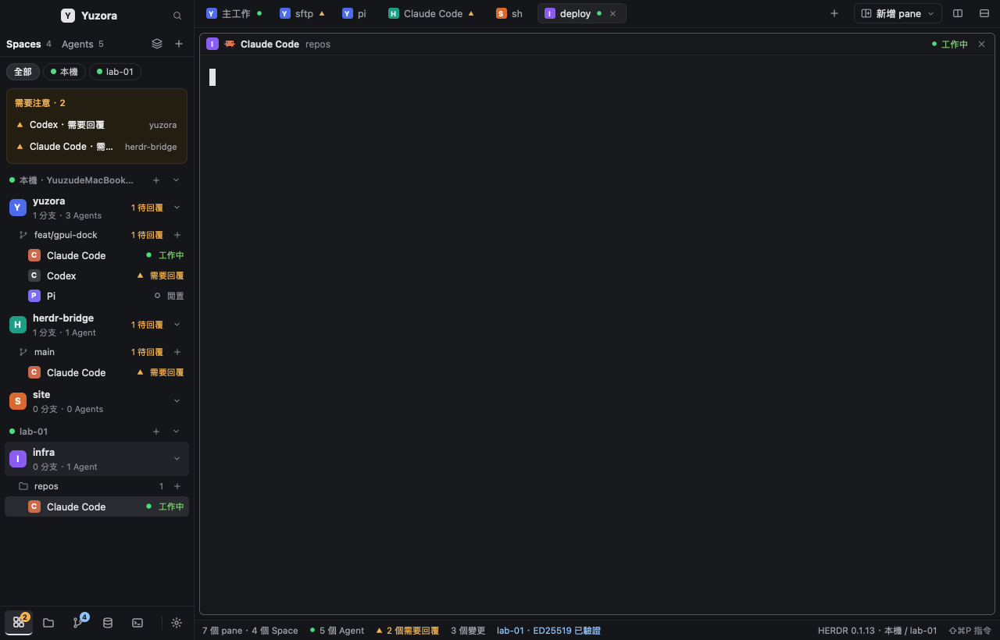

<div align="center">


# Yuzora

**Build with agents. Run on herdr-core.**

<samp>A native workspace for CLI coding agents, built on herdr-app</samp>

<br />

[](https://github.com/NakiriYuuzu/Yuzora/actions/workflows/ci.yml)
[](https://github.com/NakiriYuuzu/Yuzora/actions/workflows/app-ci.yml)


<samp>English · <a href="README.zh-TW.md">繁體中文</a> · <a href="https://github.yuuzu.net/Yuzora/en/">Website</a></samp>

</div>

<br />

> **v0.1.0-beta.2 is a preview.** Yuzora is now a native app built on
> [herdr-app](https://github.com/herdrdev/herdr-app) (Rust · GPUI · libghostty · QuickJS mods), in [`app/`](app/).
> v0.1.0-beta.1 and older are the Tauri app in `src-tauri/` and `src/`, kept in the repository as a porting
> source until beta.2 ships. Architecture: [docs/beta2/architecture.md](docs/beta2/architecture.md).

Yuzora runs your CLI coding agents (Claude Code, Codex, Pi and the other agents herdr recognizes) in herdr-core
terminals that keep running when the window closes, and puts Git, files, databases and SSH / SFTP next to them in
the same window.

<p align="center">
  <!-- TODO(L10): final English screenshots once #192 (files) and #194 (Git) are merged. -->
  
</p>

## Features

- **Spaces and agents.** A Space is a folder on this computer or on a herdr machine reached over SSH. The workspace
  sidebar lists machines → Spaces → worktrees → agents, shows each agent's state by color and shape (working, needs a
  reply, done, idle) and keeps the agents that need you in a "Needs attention" list.
- **Mixed splits.** "+ New pane" puts a tool pane (Git, editor, database, SFTP…), a terminal or an agent right of or
  below the focused pane, in the same tab.
- **Git** modeled on IntelliJ IDEA Community, with the staging area: changes and commits in the sidebar, a diff pane
  that stages hunks and lines, the log with its branch graph, branches, push, three-way merge, interactive rebase
  and annotate. Folders whose own Git config runs programs ask for your trust first.
- **Files and editor.** A file tree with Git marks and file-name and content search, a code editor with tree-sitter
  highlighting, a Markdown preview and an image viewer. Files on a remote machine open read-only in beta.2. There is
  no language server (LSP).
- **Databases**: PostgreSQL, SQL Server and SQLite, with a schema tree, a data grid that writes edited cells back in
  one transaction, the table structure and a SQL pane.
- **SSH / SFTP**: hosts from `~/.ssh/config`, Yuzora's own hosts and herdr machines; host keys checked by
  fingerprint; side-by-side SFTP whose transfers resume.
- **Settings, mods and templates.** Yuzora's own UI is herdr mods you can clone and change, and the Mods page
  installs others after a trust warning. herdr-core agent templates can be edited and started from Settings.
- English and Traditional Chinese (Taiwan), light and dark themes, both following the system by default.
- **Nothing is collected.** Telemetry is off and feedback opens a GitHub issue. An installed release checks this
  repository's GitHub Releases for updates and `releases.herdr.dev` for herdr-core's.

Not in beta.2: the Browser, Companion and AgentZone.

## Download and install

beta.2 is a pre-release on [GitHub Releases](https://github.com/NakiriYuuzu/Yuzora/releases): take the files from
its release page.

| Platform | File | Installs to |
|:--|:--|:--|
| **macOS**, Apple Silicon (M series) only | `Yuzora_<version>_aarch64.dmg`: drag Yuzora onto Applications | `/Applications/Yuzora.app`; the app adds `~/.local/bin/yuzora` |
| **Windows** x64 | `Yuzora_<version>_x64-setup.exe`, no admin rights needed | `%LOCALAPPDATA%\Programs\Yuzora`, with `yuzora` on your PATH |
| **Linux** x86_64 / aarch64 | `yuzora-<version>-linux-<arch>.tar.gz`, then run `yuzora/install` | `~/.local/share/yuzora` and `~/.local/bin/yuzora` |

Stable releases also carry fixed names that always point to the newest stable one:
`releases/latest/download/Yuzora-macos-aarch64.dmg` and `releases/latest/download/Yuzora-windows-x64-setup.exe`.
Until 0.1.0 is stable, `releases/latest` is v0.0.19, the last stable Tauri release.

- **macOS: no Apple Developer ID signature, no notarization** (ad-hoc signature only). Gatekeeper blocks the first
  open: in System Settings › Privacy & Security, click **Open Anyway**, or run
  `xattr -dr com.apple.quarantine /Applications/Yuzora.app`. Do this only for a DMG you downloaded from this
  repository's Releases. After an update, macOS may ask again for microphone, camera or folder access.
- **Windows: no Authenticode signature.** SmartScreen may warn; choose More info › Run anyway.
- **herdr-core.** Terminals and agents run in herdr-core (`hc`), version 0.1.11 or newer. If it isn't installed, the
  first screen offers to install it with herdr-core's own installer.
- Starting with v0.0.9, the macOS app requires Apple Silicon. Intel Macs remain supported as remote hosts.

Updates, coming from beta.1 and the `yuzora` command: [L7 · Release and updates](#l7--release-and-updates).
Release notes: [CHANGELOG.md](CHANGELOG.md).

## Build from source

The beta.2 app needs Rust 1.95 or newer, [Zig 0.16.0](https://ziglang.org/download/) (for ghostty) and the ghostty
submodule:

```bash
git submodule update --init app/vendor/ghostty
cd app
cargo build                    # target/debug/herdr-app
cargo test --locked            # the app, ghostty-sys and every yuzora-* crate
scripts/yuzora/check-mods      # herdr-app check on each Yuzora mod
scripts/yuzora/package         # release build and this platform's installer, into dist/
```

- `app/` is its own Cargo workspace with its own `Cargo.lock` and target (`app/target`). The Cargo package and
  binary keep upstream's name, `herdr-app`; packages call it Yuzora and `yuzora`.
- A build from source never checks for updates. Only an installed release build does.
- Don't point a development build at your own data: give it a throwaway home and core session (`YUZORA_APP_HOME`,
  `HC_SESSION`, see [docs/beta2/lanes.md](docs/beta2/lanes.md)). On macOS, `scripts/yuzora/bundle-macos <dir>` wraps
  the binary as `Yuzora.app`.

The Tauri app (v0.1.0-beta.1 and older) still builds from the repository root:

```bash
bun install
bun run tauri:dev    # desktop app (dev server :1420)
bun run test         # vitest
bun run build        # typecheck + frontend build
cargo check --locked --all-targets
```

Its release steps are in [docs/operations.md](docs/operations.md).

## Repository

| Path | What |
|:--|:--|
| [`app/`](app/) | **beta.2 app**: herdr-app brought in with `git subtree`, its own Cargo workspace |
| `app/src/yuzora/` | Yuzora's one integration point in the app: branding, switches, `yuzora:*` modules, updates |
| `app/crates/yuzora-*` | Yuzora's native layer: `yuzora-core` and one crate per area (shell, git, db, ssh, files, settings, perf) |
| `app/defaults/mods/yuzora-*` | Yuzora's mods: sidebar modes, tool panes, mode bar, status bar |
| `app/defaults/layouts/yuzora.json`, `themes/yuzora-{dark,light}.json`, `yuzora/tokens.json` | Default layout, themes and design tokens |
| `app/scripts/yuzora/`, `app/distribution/yuzora/` | Packaging, update manifest, upstream sync check |
| [`docs/beta2/`](docs/beta2/) | Architecture, lanes, the design of each area, evidence screenshots |
| `src-tauri/`, `src/` | Tauri app (v0.1.0-beta.1 and older), porting source |
| `site/`, `site-remotion/` | Website (GitHub Pages, deployed from `main`) and its video sources |

## In detail

beta.2 is built in parallel lanes, each owning its own directories and its section below. Scope and rules:
[docs/beta2/lanes.md](docs/beta2/lanes.md).

<!-- yuzora:lane:L1:start -->
### L1 · Shell and workspace

The workspace sidebar (machines → Spaces → worktrees → agents, needs attention, scope chips per machine), the mode
bar with each mode's badge, the tab bar whose "+ New pane" menu mixes tool panes, terminals and agents into one tab,
pane headers (amber while an agent needs a reply) and the status bar. A new Space starts by picking its folder; on a
remote machine you type the path, checked on that machine. `yuzora:shell` (`app/crates/yuzora-shell`) holds the
sidebar's model, Space badges and a small Git summary. Details: [docs/beta2/shell.md](docs/beta2/shell.md).
<!-- yuzora:lane:L1:end -->

<!-- yuzora:lane:L2:start -->
### L2 · Git

Git modelled on JetBrains IntelliJ IDEA Community, with the staging area:
the sidebar's Git mode (changes, staging, commit, push), a diff pane with
hunk and line staging, the commit log with its branch graph, the branches
popup, push dialog, three-way merge, interactive rebase, annotate, and a
repository pane (stashes, tags, remotes, worktrees, submodules, patches).
All git work runs in Rust (`app/crates/yuzora-git`, the `yuzora:git`
module), never on the UI thread. Design and the IntelliJ checklist:
[docs/beta2/git.md](docs/beta2/git.md).
<!-- yuzora:lane:L2:end -->

<!-- yuzora:lane:L3:start -->
### L3 · Databases

PostgreSQL, SQL Server and SQLite in the sidebar's Database mode: saved connections (passwords in the system keychain), a database picker and the schema tree; a table pane with Data (virtual grid, sorting, copying, editing cells and writing them back in one transaction), Structure (columns, indexes, foreign keys, DDL) and SQL; and a SQL pane with several result sets, cancel and history. Connections through an SSH tunnel aren't wired up yet. Native layer `app/crates/yuzora-db` (`yuzora:db`); design and limits in [docs/beta2/db.md](docs/beta2/db.md).
<!-- yuzora:lane:L3:end -->

<!-- yuzora:lane:L4:start -->
### L4 · SSH / SFTP

The SSH / SFTP sidebar mode lists hosts from `~/.ssh/config`, Yuzora's own hosts and herdr machines, with connection state and latency. A host's quick actions open SFTP (a side-by-side local ↔ host pane with a transfer queue that resumes and keeps permissions and times), a terminal there, a HERDR session (`hc machine add`) and known hosts. New host keys are confirmed by fingerprint and changed keys are flagged; Yuzora writes host keys to its own file and only reads `~/.ssh`. A remote file can open in a local text editor, and each save uploads it. `yuzora_ssh::tunnel` forwards a local port through a host, for the database mode to use later. Details: [docs/beta2/ssh.md](docs/beta2/ssh.md).
<!-- yuzora:lane:L4:end -->

<!-- yuzora:lane:L5:start -->
### L5 · Files and editor

Not started.
<!-- yuzora:lane:L5:end -->

<!-- yuzora:lane:L6:start -->
### L6 · Settings, mods and templates

Settings open on Yuzora's own pages. Herdr's settings frame gets a "Yuzora" group listing every mod that declares `"yuzora": {"settings": …}`, and Privacy and Updates speak for Yuzora (it collects and sends nothing). L6's pages:

- **General** (`yuzora-settings-general`): language (system, English, 繁體中文), look (themes, fonts, size, zoom), terminal clipboard writes (the sidebar mode at startup appears once the mode bar applies it).
- **Templates** (`yuzora-settings-templates`): herdr-core agent templates on each machine. List them, edit the frontmatter as a form and the body as text (checked before saving), move one to the trash, or start one in a Space and tab (`yuzora-settings-launch`: `hc run` with `herdr.space`/`herdr.tab` labels).
- **Mods** (`yuzora-settings-mods`): shipped, edited, cloned and personal mods and layouts with their errors. Clone, show in folder, check, switch or reset a layout, or install from a folder after a trust warning. An edited shipped mod is moved aside to `<name>-edited` and the shipped one comes back at the next start.

Native side: `app/crates/yuzora-settings` (`yuzora:settings`). Design and decisions: [docs/beta2/settings.md](docs/beta2/settings.md).
<!-- yuzora:lane:L6:end -->

<!-- yuzora:lane:L7:start -->
### L7 · Release and updates

The packages in [Download and install](#download-and-install) are made by `app/scripts/yuzora/package` and checked on all four targets by `.github/workflows/app-package.yml`.

- **Updates.** An installed Yuzora checks this repository's GitHub Releases every hour, downloads a newer version next to itself and switches to it when it restarts. The update manifest must be signed with the release key and every file must match its SHA-256, or nothing is installed. Beta builds follow the beta channel (pre-releases and stable releases), stable builds the stable one; `"update": {"channel": "stable"}` in `~/.config/yuzora/yuzora/settings.json` picks another.
- **Coming from 0.1.0-beta.1.** When a beta.2 release offers it, beta.1's own updater (Settings › Updates, preview channel) moves you to beta.2; otherwise use the downloads above. beta.1's data stays where it was. Bringing connections and settings over isn't wired up yet, so set them up again for now. On Windows, the installer offers to remove the old all-users install.
- **The command line program is `yuzora`** (the same commands as `herdr-app`: `yuzora status`, `yuzora do …`). Yuzora never puts `herdr-app` on your PATH, so an official Herdr install keeps its own.

Design, keys and the release steps: [docs/beta2/release.md](docs/beta2/release.md).
<!-- yuzora:lane:L7:end -->

<!-- yuzora:lane:L8:start -->
### L8 · Resource usage

The chip in the window's bottom-right corner shows what this computer's Yuzora uses (the app, its herdr-core with
the terminals and agents in it, and the tools the app starts) as `{cpu}% · {memory}MB`, and opens the details above
it. `yuzora:perf` (`app/crates/yuzora-perf`) samples on a worker thread every 2 s while the window is in front.
Remote (SSH) Spaces aren't measured. Details: [docs/beta2/perf.md](docs/beta2/perf.md).
<!-- yuzora:lane:L8:end -->

<!-- yuzora:lane:L9:start -->
### L9 · Using Yuzora beside Herdr

Yuzora and the official Herdr app can run at the same time on one herdr-core (its default session). Each keeps its
own Spaces, tabs and layout. The terminals belong to herdr-core, so both apps see them. Keep in mind:

- **Closing a Space, tab or pane ends its terminals, whichever app opened them.** Each app gathers the other's
  terminals into Spaces of its own. Closing one of those in Yuzora ends the terminal in Herdr too, and the other way
  round. To close work Herdr opened, close it in Herdr.
- **herdr-core starts again while either app is open.** After `hc server stop`, the open app starts the core again
  within about a second, and every program in its terminals ends (kept terminals come back with a fresh shell). To
  stop the core for good, quit both apps first.
- **Herdr's settings and mods aren't imported.** To bring a mod over, copy its folder from Herdr's `mods/` into
  Yuzora's: `~/.config/herdr-app/mods/` and `~/.config/yuzora/mods/` by default, under `XDG_CONFIG_HOME` when that is
  set, or in the folders `HERDR_APP_HOME` and `YUZORA_APP_HOME` name if you set them. Or pick the mod's folder in
  Settings › Mods › Install from folder… (which never overwrites a mod you have). `keys.json` and themes can be
  copied the same way; don't copy `installed.json`. Yuzora's own `yuzora-*` mods don't load in Herdr.
- **Machines and agent templates are shared.** Both apps use herdr-core's machine list and its templates folder
  (`~/.config/herdr-core/templates/`; on Windows `%APPDATA%\herdr-core\templates`; `$XDG_CONFIG_HOME/herdr-core/templates/`
  when that is set). A machine you add, rename or remove, or a template you edit in Yuzora's Settings, changes for
  Herdr as well.
- **When the core changes under Yuzora.** If herdr-core restarts as a version Yuzora can't use (for example Herdr
  moved it to a newer generation), Yuzora doesn't connect to it and keeps the reason on screen; click it to open
  Settings › Updates. It connects again on its own once the core is fixed.

Details and the decisions behind this: [docs/beta2/herdr-compat.md](docs/beta2/herdr-compat.md).
<!-- yuzora:lane:L9:end -->

## License

The beta.2 app builds on [herdr-app](https://github.com/herdrdev/herdr-app) (Apache-2.0); its license and
third-party notices are in [`app/LICENSE`](app/LICENSE) and [`app/THIRD-PARTY-NOTICES`](app/THIRD-PARTY-NOTICES).

<br />

---

<div align="center">

**An ADE built on herdr-core.**

<samp>agent development under the evening sky</samp>

<sub>

[Source](https://github.com/NakiriYuuzu/Yuzora) · [Issues](https://github.com/NakiriYuuzu/Yuzora/issues) · [Releases](https://github.com/NakiriYuuzu/Yuzora/releases) · [Website](https://github.yuuzu.net/Yuzora/)

</sub>

</div>
