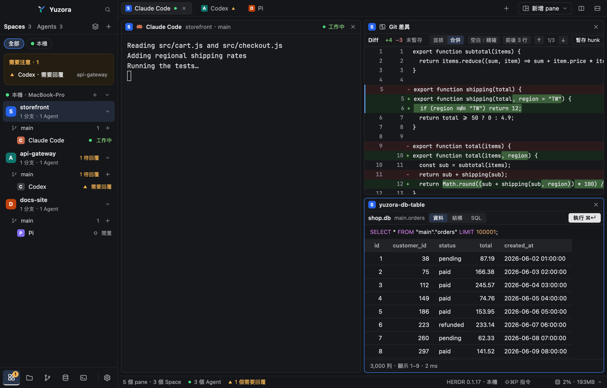
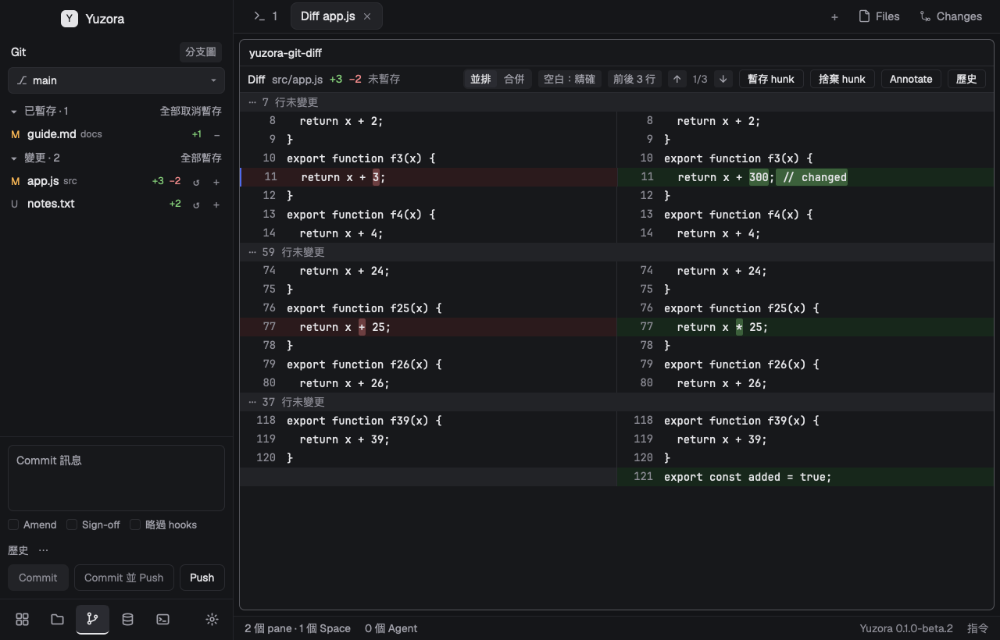
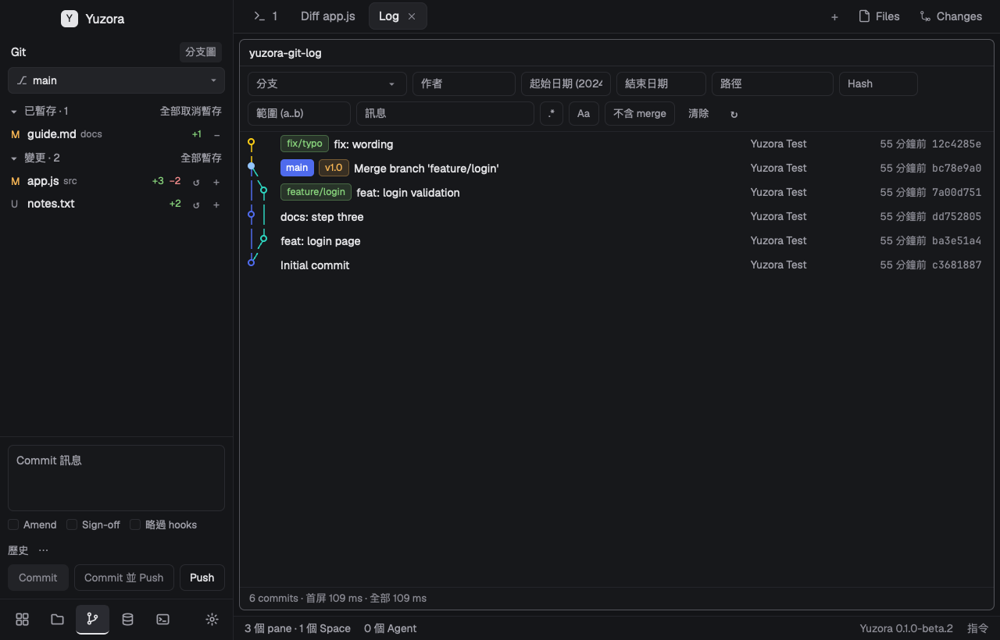
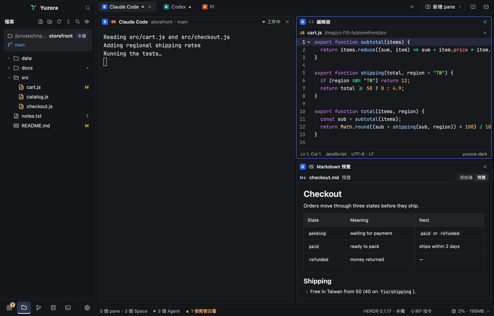

<div align="center">


# Yuzora

**讓 agent 開發，直接運轉在 herdr-core。**

<samp>以 herdr-app 打造、給 CLI coding agents 的原生工作區</samp>

<br />

[](https://github.com/NakiriYuuzu/Yuzora/actions/workflows/ci.yml)
[](https://github.com/NakiriYuuzu/Yuzora/actions/workflows/app-ci.yml)


<samp><a href="README.md">English</a> · 繁體中文 · <a href="https://github.yuuzu.net/Yuzora/">官方網站</a></samp>

</div>

<br />

> **v0.1.0-beta.2 是預覽版。** Yuzora 改以 [herdr-app](https://github.com/herdrdev/herdr-app)
> （Rust · GPUI · libghostty · QuickJS mods）為基底，成為原生 App，程式在 [`app/`](app/)。
> v0.1.0-beta.1 以前的版本是 `src-tauri/` 與 `src/` 的 Tauri App，保留在 repo 裡當移植來源，直到 beta.2 發布。
> 架構見 [docs/beta2/architecture.md](docs/beta2/architecture.md)。

Yuzora 讓 CLI coding agents（Claude Code、Codex、Pi，以及其他 herdr 認得的 agent）跑在 herdr-core 的終端機裡，
關掉視窗也會繼續執行；Git、檔案、資料庫與 SSH／SFTP 就在旁邊，同一個視窗裡。

<p align="center">
  
</p>

## 功能

- **Spaces 與 agents。** 一個 Space 是這台電腦上的資料夾，或是經 SSH 連到的 herdr machine 上的資料夾。工作區側欄依
  機器 → Space → worktree → agent 排列，每個 agent 的狀態同時以顏色與形狀表示（工作中、需要回覆、完成、閒置），
  需要你處理的 agent 會集中在「需要注意」區。
- **混合分割。**「＋ 新增 pane」把工具 pane（Git、編輯器、資料庫、SFTP⋯）、終端機或 agent 放在目前 pane 的右側或
  下方，都在同一個 tab 裡。
- **Git** 以 IntelliJ IDEA Community 為基準，採 staging area 模式：側欄處理變更與 commit，diff pane 可以逐塊、逐行
  暫存，另有提交紀錄與分支圖、分支、push、三方合併、互動式 rebase 與 annotate。repo 自己的 Git 設定會執行程式的
  資料夾，要先信任才會動作。
- **檔案與編輯器。** 帶 Git 標記的檔案樹、檔名與內容搜尋、tree-sitter 上色的程式碼編輯器、Markdown 預覽，以及圖片
  與 SVG 檢視（repo 的 SVG 在獨立的行程裡畫，有時間與記憶體上限）。beta.2 的遠端機器檔案以唯讀開啟。不提供 language
  server（LSP）。
- **資料庫**：PostgreSQL、SQL Server、SQLite。schema 樹、可在單一交易內寫回修改的資料表格、資料表結構與 SQL pane。
- **SSH／SFTP**：主機來自 `~/.ssh/config`、Yuzora 自建主機與 herdr machines；以指紋確認主機金鑰；SFTP 雙欄傳輸可以
  續傳。
- **設定、mods 與模板。** Yuzora 自己的介面就是 herdr mods，可以複製後修改；MOD 頁在顯示信任警告後，也能從資料夾
  安裝別人的 mod。herdr-core 的 agent 模板可以在設定裡編輯與啟動。
- 介面支援英文與繁體中文，深色與淺色主題，預設都跟隨系統。
- **不收集任何資料。** 遙測已關閉，意見回饋改開 GitHub Issue。安裝好的正式版會向本 repo 的 GitHub Releases 檢查
  Yuzora 更新，並向 `releases.herdr.dev` 檢查 herdr-core 的版本。

<p align="center">
  
  
</p>

<p align="center">
  
</p>

beta.2 不包含：Browser、Companion 與 AgentZone。

## 下載與安裝

beta.2 是 Pre-release，目前請從 [GitHub Releases](https://github.com/NakiriYuuzu/Yuzora/releases) 上該版本的頁面下載。
官方網站在 0.1.0 正式版發布前，仍提供 Tauri 版最後一個正式版 v0.0.19。

| 平台 | 檔案 | 安裝位置 |
|:--|:--|:--|
| **macOS**，僅支援 Apple Silicon（M 系列） | `Yuzora_<version>_aarch64.dmg`：把 Yuzora 拖進「應用程式」 | `/Applications/Yuzora.app`；App 會建立 `~/.local/bin/yuzora` |
| **Windows** x64 | `Yuzora_<version>_x64-setup.exe`，不需要系統管理員權限 | `%LOCALAPPDATA%\Programs\Yuzora`，並把 `yuzora` 加進 PATH |
| **Linux** x86_64／aarch64，實驗性 | `yuzora-<version>-linux-<arch>.tar.gz`，解開後執行 `yuzora/install` | `~/.local/share/yuzora` 與 `~/.local/bin/yuzora` |

從 0.1.0 正式版起，正式版另外提供固定檔名，永遠指向最新的正式版：`releases/latest/download/Yuzora-macos-aarch64.dmg`
與 `releases/latest/download/Yuzora-windows-x64-setup.exe`。在那之前 `releases/latest` 仍是 Tauri 版最後一個正式版
v0.0.19：DMG 是 Tauri 版，Windows 的連結會 404（v0.0.19 的檔名是 `Yuzora-windows-x64.msi`）。beta.2 請從它的
pre-release 頁面下載。

- **macOS 沒有 Apple Developer ID 簽章，也沒有公證**（只有 ad-hoc 簽章）。第一次開啟會被 Gatekeeper 擋下：到
  「系統設定 › 隱私權與安全性」按「強制打開」，或在終端機執行 `xattr -dr com.apple.quarantine /Applications/Yuzora.app`。
  只對從本 repo Releases 下載的 DMG 這樣做。更新之後，macOS 可能會再詢問一次麥克風、相機或資料夾的存取權限。
- **Windows 沒有 Authenticode 簽章。** SmartScreen 可能出現警告，請點「其他資訊 › 仍要執行」。
- **Linux 是實驗性的。** tar.gz 與 `install` 目前只通過 CI，尚未在實機上驗證。
- **herdr-core。** 終端機與 agent 由 herdr-core（`hc`）執行，需要 0.1.11 以上。還沒安裝時，第一次開啟的畫面會提供
  「幫我安裝」，使用 herdr-core 官方的安裝程式。
- 從 v0.0.9 起，macOS App 僅支援 Apple Silicon；Intel Mac 仍可當遠端主機。

更新、從 beta.1 升級與 `yuzora` 指令：見 [L7 · 發布與更新](#l7--發布與更新)。版本紀錄：[CHANGELOG.zh-TW.md](CHANGELOG.zh-TW.md)。

## 從原始碼建置

beta.2 App 需要 Rust 1.95 以上、[Zig 0.16.0](https://ziglang.org/download/)（ghostty 用）與 ghostty submodule：

```bash
git submodule update --init app/vendor/ghostty
cd app
cargo build                    # target/debug/herdr-app
cargo test --locked            # App、ghostty-sys 與全部 yuzora-* crate
scripts/yuzora/check-mods      # 對每個 Yuzora mod 執行 herdr-app check
scripts/yuzora/package         # release build，並在 dist/ 產生這個平台的安裝檔
```

- `app/` 是獨立的 Cargo workspace，有自己的 `Cargo.lock` 與 target（`app/target`）。Cargo package 與執行檔沿用上游的
  名稱 `herdr-app`，打包後才叫 Yuzora 與 `yuzora`。
- 從原始碼建置的版本不會檢查更新，只有安裝好的正式 build 會。
- 不要讓開發中的 build 讀寫你自己的資料：給它暫存的 app home 與 core session（`YUZORA_APP_HOME`、`HC_SESSION`，見
  [docs/beta2/lanes.md](docs/beta2/lanes.md)）。macOS 上可用 `scripts/yuzora/bundle-macos <dir>` 包成 `Yuzora.app`。

Tauri App（v0.1.0-beta.1 以前）仍可在 repo 根目錄建置：

```bash
bun install
bun run tauri:dev    # 桌面 App（dev server :1420）
bun run test         # vitest
bun run build        # typecheck＋前端建置
cargo check --locked --all-targets
```

它的發布步驟見 [docs/operations.md](docs/operations.md)。

## Repo 結構

| 路徑 | 內容 |
|:--|:--|
| [`app/`](app/) | **beta.2 App**：以 `git subtree` 引入的 herdr-app，獨立的 Cargo workspace |
| `app/src/yuzora/` | Yuzora 在 App 裡唯一的整合點：品牌、開關、`yuzora:*` 模組、更新 |
| `app/crates/yuzora-*` | Yuzora 的原生層：`yuzora-core` 與各功能一個 crate（shell、git、db、ssh、files、settings、perf） |
| `app/defaults/mods/yuzora-*` | Yuzora 的 mods：側欄模式、工具 pane、模式列、狀態列 |
| `app/defaults/layouts/yuzora.json`、`themes/yuzora-{dark,light}.json`、`yuzora/tokens.json` | 預設 layout、主題與設計 tokens |
| `app/scripts/yuzora/`、`app/distribution/yuzora/` | 打包、更新 manifest、上游同步檢查 |
| [`docs/beta2/`](docs/beta2/) | 架構、lanes、各功能的設計文件與實機截圖 |
| `src-tauri/`、`src/` | Tauri App（v0.1.0-beta.1 以前），移植來源 |
| `site/`、`site-remotion/` | 官方網站（GitHub Pages，從 `main` 部署）與影片原始碼 |

## 功能細節

beta.2 分成多條 lane 並行開發，每條 lane 擁有自己的目錄與下面的一節。範圍與規則見
[docs/beta2/lanes.md](docs/beta2/lanes.md)。

### L1 · 外殼與工作區

工作區側欄（機器 → Space → worktree → agent、「需要注意」區、每台機器的 scope chip）、帶各模式徽章的模式列、
可用「＋ 新增 pane」把工具 pane、終端機與 agent 混合分割進同一個 tab 的 tab 列、pane 標頭（agent 需要回覆時轉為
琥珀色）與狀態列。新增 Space 時先選資料夾；遠端機器改成輸入路徑，並在那台機器上確認。`yuzora:shell`
（`app/crates/yuzora-shell`）提供側欄的模型、Space 徽章與簡單的 Git 摘要。細節見
[docs/beta2/shell.md](docs/beta2/shell.md)。

### L2 · Git

以 JetBrains IntelliJ IDEA Community 為基準、採 staging area 模式的 Git：側欄 Git 模式（變更、暫存、commit、push）、
可逐塊與逐行暫存的 diff pane、提交紀錄與分支圖、分支 popup、push 對話框、三方合併、互動式 rebase、annotate，以及
repo pane（stash、tag、remote、worktree、submodule、patch）。所有 git 工作都在 Rust（`app/crates/yuzora-git`，
`yuzora:git` 模組）執行，不在 UI 執行緒。設計與 IntelliJ 對照清單見 [docs/beta2/git.md](docs/beta2/git.md)。

### L3 · 資料庫

側欄「資料庫」模式支援 PostgreSQL、SQL Server、SQLite：儲存的連線（密碼存在系統鑰匙圈）、資料庫切換與 schema
樹；資料表 pane 有資料（虛擬捲動表格、排序、複製、編輯儲存格並在單一交易內寫回）、結構（欄位、索引、外鍵、DDL）
與 SQL 分頁；SQL pane 可執行多個結果集、取消與查看歷史紀錄。經 SSH tunnel 連線尚未接上。原生層是
`app/crates/yuzora-db`（`yuzora:db`），設計與限制見 [docs/beta2/db.md](docs/beta2/db.md)。

### L4 · SSH／SFTP

側欄 SSH／SFTP 模式列出 `~/.ssh/config`、Yuzora 自建主機與 herdr machines，並顯示連線狀態與延遲。主機的快速動作：
開啟 SFTP（本機 ↔ 主機雙欄，傳輸佇列可以續傳，並保留權限與時間）、在那台主機開終端機、HERDR Session
（`hc machine add`）與已知主機。新的主機金鑰以指紋確認，金鑰變更時會警告；Yuzora 只把主機金鑰寫進自己的檔案，
`~/.ssh` 只讀不寫。遠端檔案可以用本機的文字編輯器開啟，每次存檔都會自動上傳。`yuzora_ssh::tunnel` 可經由主機轉送
本機埠，之後給資料庫模式使用。細節見 [docs/beta2/ssh.md](docs/beta2/ssh.md)。

### L5 · 檔案與編輯器

- 側欄**檔案**模式：以樹狀顯示目前 pane 所在的 repo，帶 Git 標記（M／A／D／U／?）；新增檔案與資料夾、重新命名、刪除到
  垃圾桶、複製路徑、在 Finder 中顯示；檔名模糊搜尋與內容搜尋（有安裝 ripgrep 就用它，否則用內建搜尋）。
- **編輯器** pane：14 種語言的 tree-sitter 上色，存檔時檢查衝突（⌘S），尋找與取代（⌘F／⌘H）。磁碟上的變更會即時跟上，
  有 agent 在改同一個檔案時會顯示。
- **Markdown** pane：GFM 預覽，跟著編輯器即時更新，可以切換原始碼與預覽。另有圖片與 SVG 檢視。
- beta.2 可以瀏覽並以唯讀開啟其他機器（遠端 Space）上的檔案。

細節見 [docs/beta2/files.md](docs/beta2/files.md)。

### L6 · 設定、mods 與模板

設定改從 Yuzora 自己的頁面開啟。Herdr 的設定畫面多了「Yuzora」分組，列出每個在 `mod.json` 宣告
`"yuzora": {"settings": …}` 的 mod；隱私與更新頁改為說明 Yuzora 的做法（不收集也不傳送任何資料）。L6 的頁面：

- **一般**（`yuzora-settings-general`）：語系（跟隨系統、English、繁體中文）、外觀（主題、字型、字級、縮放）、終端機
  剪貼簿寫入（啟動時的側欄模式要等模式列套用後才會出現）。
- **模板**（`yuzora-settings-templates`）：各台機器上的 herdr-core agent 模板。可以列出、以表單編輯 frontmatter、以
  文字編輯 body（存檔前檢查）、移到垃圾桶，或啟動到指定的 Space 與 tab（`yuzora-settings-launch`：帶
  `herdr.space`／`herdr.tab` label 的 `hc run`）。
- **MOD**（`yuzora-settings-mods`）：內建、已修改、複製與個人的 mods 與 layouts，以及它們的錯誤。可以複製、在資料夾中
  顯示、檢查、切換或還原 layout，或在顯示信任警告後從資料夾安裝。改過的內建 mod 會在下次啟動時移到
  `<名稱>-edited`，並換回內建版本。

原生層是 `app/crates/yuzora-settings`（`yuzora:settings`），設計與決策見 [docs/beta2/settings.md](docs/beta2/settings.md)。

### L7 · 發布與更新

[下載與安裝](#下載與安裝)裡的安裝檔由 `app/scripts/yuzora/package` 產生，`.github/workflows/app-package.yml` 會在
四個平台上檢查。

- **更新。** 安裝好的 Yuzora 每小時檢查一次本 repo 的 GitHub Releases，把新版下載到自己旁邊，重新啟動時換上。更新
  清單必須以 release 金鑰簽章，每個檔案也必須符合它的 SHA-256，否則什麼都不會安裝。beta build 只會更新到正式版
  （0.1.0 以後），不會更新到其他 beta，beta 請手動下載；正式 build 走 stable 通道，要連 Pre-release 一起收，在
  `~/.config/yuzora/yuzora/settings.json` 寫 `"update": {"channel": "beta"}`。
- **從 0.0.x 或 0.1.0-beta.1 升級。** 請自行下載安裝 beta.2（見[下載與安裝](#下載與安裝)）：舊版 App 的更新不會提供
  beta.2，要等 0.1.0 Stable 才能在舊版 App 裡更新到新版。beta.1 的資料留在原處；連線與設定的搬移還沒接上，目前要重新設定。Windows 的安裝程式
  會詢問是否移除舊的全機安裝。
- **命令列程式叫 `yuzora`**（指令和 `herdr-app` 相同：`yuzora status`、`yuzora do …`）。Yuzora 不會在 PATH 放
  `herdr-app`，官方 Herdr 的 CLI 不受影響。

設計、金鑰與發布步驟見 [docs/beta2/release.md](docs/beta2/release.md)。

### L8 · 資源用量

視窗右下角的 chip 以 `{cpu}% · {memory}MB` 顯示這台電腦上 Yuzora 的用量（App 本體、herdr-core 與其中的終端機和
agents、App 啟動的工具），點擊會往上展開明細。`yuzora:perf`（`app/crates/yuzora-perf`）在視窗位於前景時，於 worker
執行緒每 2 秒取樣一次。SSH 遠端 Space 不計入。細節見 [docs/beta2/perf.md](docs/beta2/perf.md)。

### L9 · 和 Herdr 一起使用

Yuzora 與官方 Herdr App 可以同時使用同一個 herdr-core（預設 session）。兩邊各自保留自己的 Spaces、tabs 與 layout；
終端機屬於 herdr-core，兩個 App 都看得到。請注意：

- **關閉 Space、tab 或 pane 會結束其中的終端機，不論是哪個 App 開的。** 兩個 App 都會把對方的終端機收進自己的
  Space。在 Yuzora 關掉其中一個，Herdr 那邊的終端機也會結束，反過來也一樣。要關掉 Herdr 開的工作，請在 Herdr 關。
- **只要任一個 App 開著，herdr-core 就會重新啟動。** 執行 `hc server stop` 後，開著的 App 約一秒內就會重新啟動 core，
  終端機裡的程式全部結束（保留的終端機會換成新的 shell）。要真的停止 core，先關掉兩個 App。
- **不會匯入 Herdr 的設定與 mods。** 要搬一個 mod，把它的資料夾從 Herdr 的 `mods/` 複製到 Yuzora 的 `mods/`：預設是
  `~/.config/herdr-app/mods/` 與 `~/.config/yuzora/mods/`，設了 `XDG_CONFIG_HOME` 時在它底下，設了 `HERDR_APP_HOME`、
  `YUZORA_APP_HOME` 時則在它們指定的資料夾。也可以在「設定 › MOD › 從資料夾安裝…」選那個 mod 的資料夾（不會覆寫已有的
  mod）。`keys.json` 與 themes 也能這樣複製；不要複製 `installed.json`。Yuzora 自己的 `yuzora-*` mods 在 Herdr 無法
  載入。
- **machines 與 agent 模板是共用的。** 兩個 App 用的是 herdr-core 的機器清單與模板資料夾
  （`~/.config/herdr-core/templates/`；Windows 是 `%APPDATA%\herdr-core\templates`；設了 `XDG_CONFIG_HOME` 時是
  `$XDG_CONFIG_HOME/herdr-core/templates/`）。在 Yuzora 新增、改名或移除機器，或在設定裡編輯模板，Herdr 那邊也會跟著
  變。
- **core 在背後被換掉時。** herdr-core 重新啟動後若變成 Yuzora 不能用的版本（例如 Herdr 把它換成新一代），Yuzora 不會
  接上，並一直顯示原因；點一下會開啟「設定 › 更新」。core 恢復後會自動重新連線。

細節與背後的決策見 [docs/beta2/herdr-compat.md](docs/beta2/herdr-compat.md)。

## 授權

beta.2 App 以 [herdr-app](https://github.com/herdrdev/herdr-app)（Apache-2.0）為基礎；授權與第三方聲明見
[`app/LICENSE`](app/LICENSE) 與 [`app/THIRD-PARTY-NOTICES`](app/THIRD-PARTY-NOTICES)。

<br />

---

<div align="center">

**以 herdr-core 為核心的 ADE。**

<samp>夕空下的 agent development environment</samp>

<sub>

[原始碼](https://github.com/NakiriYuuzu/Yuzora) · [回報問題](https://github.com/NakiriYuuzu/Yuzora/issues) · [所有版本](https://github.com/NakiriYuuzu/Yuzora/releases) · [官方網站](https://github.yuuzu.net/Yuzora/)

</sub>

</div>
