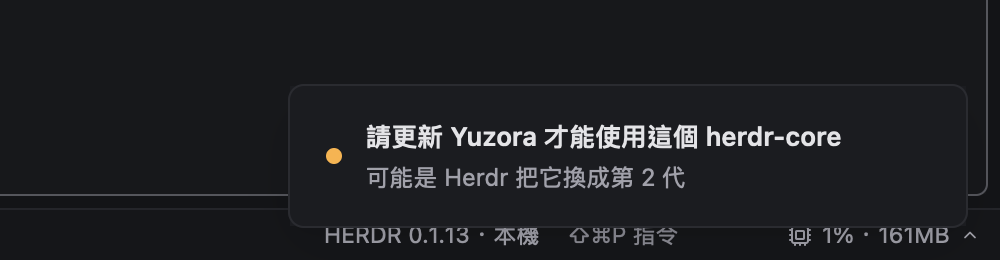

# L9 Herdr 相容與上游更新

lane L9 負責兩件事：

- 讓 Yuzora 和使用者同時安裝的官方 Herdr.app 盡量互不干擾。
- 維持 herdr-app 上游與 herdr-core 的更新。

本文是相容性盤點、已修項目、已決定的取捨（2026-11-03，使用者），以及上游同步的做法。給使用者的說明在根目錄 `README.md` 與 `app/defaults/AGENTS.md` 的 L9 區塊。架構決策見 [architecture.md](architecture.md)（D1 subtree、D3 外連、D4 layout 名稱），lane 流程見 [lanes.md](lanes.md)。

- 盤點環境（2026-11-03，macOS aarch64）：
  - Yuzora：`beta2/integration` `ca2a08c7`，herdr-app 上游 `9c678b0`。
  - Herdr.app：0.1.12（`/Applications/Herdr.app`）。
  - herdr-core：`hc` 0.1.13（`~/.local/bin/herdr-core`）。
- 實測一律在隔離環境：`env -i`、`HC_SESSION=yuzora-l9-test`、XDG 目錄指到 `/tmp/yz-l9-run`。Yuzora 用 `YUZORA_APP_HOME`，Herdr.app 用 `HERDR_APP_HOME`，另外設 `HERDR_TELEMETRY=0` 和指向無效位址的 `HERDR_RELEASES_URL`。Herdr.app 直接執行 `Contents/MacOS/Herdr`，不經過 `open`。使用者的預設 core 沒有被停止或升級。指令見文末「實測紀錄」。

## 總表

前提：兩個 app 連到同一個 core（預設 session）。

| 項目 | 現況 | 風險 | 處理 |
| --- | --- | --- | --- |
| layout 文件（`doc.*`） | 分開：Yuzora 寫 `yuzora`，Herdr 寫 `herdr-app` | 無 | 維持（D4） |
| app home（settings、keys、themes、layouts、mods、shared） | 分開：`~/.config/yuzora` 與 `~/.config/herdr-app` | 無 | 維持（D3） |
| 終端機 label | 兩邊寫同一組 `herdr.*` 與 `where` | 低：`where` 最後寫入者勝，只影響顯示 | 記錄 |
| **收養與關閉** | 兩邊都把對方的終端機收進自己的 Space；**在任一邊關閉 pane／tab／Space 會在 core 結束它** | **高**：會誤殺對方的終端機 | **決定 1**：維持，使用說明寫清楚；D4 已更正 |
| machines catalog | core 的，兩邊共用 | 中：一邊移除或改名，另一邊跟著變 | 記錄（設計如此） |
| herdr-core 模板 | Yuzora（L6）直接寫 core 的 templates 資料夾；Herdr 只讀 | 低：改了模板，兩邊的 `hc run <模板>` 都會變 | 記錄（設計如此） |
| `config.toml`、agent hooks | 兩邊都不寫 | 無 | — |
| `hc server stop` | 任何一個 app 開著時，1 秒內會被它重新啟動 | 中：所有程式結束，kept 終端機換成新 shell | 決定 4：維持，使用說明寫清楚 |
| `hc server restart`、`hc update` | 兩邊約 1 秒內重連，程式不中斷 | 低 | 記錄 |
| Yuzora 自動升級 core | Yuzora 自我更新後，第一次啟動會把共用 core 升到最新同代版本 | 低：Herdr 的 core 也跟著重啟 | 決定 5：維持 |
| 版本 gating（啟動時） | 會擋，但 setup 畫面寫的是「Herdr」 | 低：使用者看不懂 | **已修 B1** |
| 版本 gating（重連時） | **不檢查**：別的 app 換掉 core 後，Yuzora 默默接上不相容的 core | 中：之後的呼叫用難懂的方式失敗 | **已修 B2** |
| mods | Herdr 的 mod 可直接裝進 Yuzora；Yuzora 的 `yuzora-*` mod 在 Herdr 載入時明確失敗 | 低 | 決定 3：不匯入，使用說明寫手動複製 |
| keymap、themes、settings.json | 格式相同，可互相複製 | 低 | 記錄 |
| Space、tab | 不共用；終端機共用 | 見「收養與關閉」 | 決定 2：維持分開 |

## A. 盤點

### A1. 兩邊寫進 core 的東西

core 的資料都放在 `$XDG_STATE_HOME/herdr-core/<session>/`：`docs.json`、`terminals.json`、`machines.json`、`screens/`。config 放在 `$XDG_CONFIG_HOME/herdr-core/`：`config.toml`、`templates/`。

| 寫入 | Yuzora | Herdr.app | 會互相覆寫嗎 |
| --- | --- | --- | --- |
| `doc.set`／`doc.get` | 名稱 `yuzora`，本機和每台 machine 都是（`app/src/mirror_sync.rs:77`、`:96`；`CORE_DOCUMENT`，`app/src/yuzora/mod.rs`） | `herdr-app` | 不會。實測 `docs.json` 有兩個 key，各自從 version 3 起算 |
| `terminal.run` 的 label | `herdr.space`、`herdr.tab`、`herdr.seen=0`；env 帶 `TERM_PROGRAM=herdr`（`app/src/window.rs:2326`、`app/src/hc.rs`） | 同 | 不會：每個終端機只由建立它的 app 寫一次 |
| `herdr.seen` | 看過的 turn，只增不減（`window.rs:1511` `share_seen`） | 同 | 設計上共用：在一邊看過，另一邊也算已讀（`docs/labels.md`） |
| `where` | `<space> / <tab>`，給 `hc ls` 和 picker 顯示（`window.rs:1730` `write_where`） | 同 | **最後寫入者勝**。實測 `t1` 是 Yuzora 的 `yz-space`，`where` 卻是 Herdr 寫的 `tmp / 1`。兩邊都只快取自己上次寫的值，所以不會來回改 |
| `herdr.pinned`、`herdr.right-click` | `terminal.pin`、`terminal.right_click` | 同 | 設計上共用（pin 會在所有 client 顯示） |
| `herdr.space`／`herdr.tab` 改寫 | `terminal.keep` 改成 Yuzora 的 id；`terminal.park` 清空（`window.rs:2977`、`:2981`） | 同 | 只影響「沒有 pane 的終端機」之後由誰收養 |
| `terminal.kill` | 關閉 pane／tab／Space、`terminal.kill` 指令（`window.rs:2591` `kill`） | 同 | **會**：見 A5 |
| machines | `hc machine add／rm／rename／update`，只在 UI 按鈕觸發（`defaults/mods/machine-add`、`defaults/frame/settings`、`yuzora-sidebar-ssh` 只讀） | 同（同一份上游程式） | 共用 `machines.json`：一邊移除，另一邊也不見 |
| 模板 | `crates/yuzora-settings/src/templates.rs:271-280`、`:420` 直接寫 `<config>/herdr-core/templates/<name>.md`；遠端透過 `hc exec` | 只讀（上游沒有模板編輯器） | 沒有 key 衝突；內容兩邊共用 |
| `config.toml` | 不寫 | 不寫 | — |
| agent hooks | 沒有（hc 0.1.13 沒有 hooks 指令，狀態由 core 偵測） | 沒有 | — |
| shared state（`setShared`） | `<app home>/shared.json`（`app/src/mods.rs:437`） | 自己的 home | 不在 core，不共用 |

另外：

- 任何 doc 事件都會讓 Yuzora 重讀自己的 `yuzora` 文件（`app/src/hc.rs` `EventLines::push`）。所以 Herdr 每改一次 layout，Yuzora 就多一次 `doc.get`。只是多一個 RPC，不會寫入。
- mod 可以透過 `hc(args)` 執行任何 `hc` 子指令（`app/defaults/herdr.d.ts`、`app/src/mods.rs` `hc`），包括 `server stop` 和 `update`。內建 mod 都沒有這樣用，使用者自己裝的 mod 則可能。

### A2. core 的生命週期

| 事件 | 結果（實測） |
| --- | --- |
| `hc server restart` | 兩個 app 都在約 1 秒內記錄 `lost the core; reconnecting` → `reconnected to the core`。`t1` 的 pid 不變（95144），程式沒有中斷 |
| `hc server stop` | 兩個 app 的重連迴圈每秒執行一次 `hc connect`，而 `hc connect` 在沒有 core 時會啟動 core（`app/src/hc.rs:275`）。實測停止後約 1 秒，core 就被 Herdr.app 的 `hc connect` 重新啟動（新 pid 97885，父行程是 Herdr）。**程式全部結束**：kept 的 `t1` 換成新 shell（pid 95144 → 97894），非 kept 的終端機則結束 |
| 關閉其中一個 app | core 繼續執行（實測結束 Herdr.app 後，core pid 97885 沒變，改由 launchd 收養） |
| `hc update`（同一代） | 等同 restart，程式不中斷，另一個 app 自動重連 |
| 升級到新一代（generation） | `hc update` 預設不跨代；要跨代得加 `--force`（`hc update --help`：允許另一代的 release），或重新安裝。app 自己的更新路徑都不帶 `--force`。換代之後，舊代的 app 不能用這個 core（見 A3） |

結論：

- **Yuzora 從不停止 core**。它沒有呼叫 `server.stop`／`server.restart`。關閉時只結束自己的 `hc connect` 連線（`Core` 的 `Drop`）。
- 會重啟 core 的情況：
  - setup 畫面或設定頁按「Update herdr-core」（`app.update_core`，`app/src/update.rs:244` `update_core`、`app/src/core_bin.rs:202` `update_to`）。
  - Yuzora 自我更新後第一次啟動，自動執行 `hc update --version <目標>`（`update.rs:600` `after_update`）。目標是最新的同代 release，取不到時改用 `core-version`。`--version` 是「至少這版」，不會降版。
  - 這些都和 Herdr.app 的行為相同。core 由 Homebrew、Nix、mise 管理時都不會更新（`installed_by`）。
- 兩個 app 要求的 core 版本不同時：
  - 同一代：較新的 core 只會增加功能。哪一邊把 core 升上去，另一邊都能用。現在兩邊的下限都是 0.1.11。
  - 不同代：沒有辦法同時滿足兩邊，只能讓落後的 app 跟上。

### A3. 版本與 protocol gating

- Yuzora 支援的 core：**generation 1、0.1.11 以上，並且提供 `USES` 列的 9 個方法**（`app/src/hc.rs:177`、`:179`；`app/distribution/core-version`）。沒有上限：同一代較新的 core 都可以。本機以 0.1.13 實測。Herdr.app 0.1.12 的條件完全相同（上游 v0.1.8～v0.1.12 的 `core-version` 都是 0.1.11）。
- 判斷方式：`hc connect` 後送 `hello`，core 回傳 `generation`、`version`、`methods`。`hc::check`（`hc.rs:222`）分三種情況：
  - `Newer`：core 的 generation 比 app 新，要更新 app。
  - `TooOld`：generation 較舊，或版本低於 `core-version`，要更新 core。
  - `Missing`：缺少 `USES` 的方法，要更新 core。
- 啟動時會檢查（`app/src/main.rs:133`、`app/src/setup.rs:65`），不符就顯示 setup 畫面。修正前畫面寫的是「Herdr needs…」「Update Herdr: …」。這是 B1。
- **重連時原本不檢查**（`app/src/window.rs:696` 起的迴圈）。另一個 app 換掉或降版 core 後（例如安裝新一代），Yuzora 會直接接上，之後的呼叫才以難懂的方式失敗。這是 B2。

### A4. mods、keymap、themes、layouts、settings.json

| 項目 | Herdr → Yuzora | Yuzora → Herdr |
| --- | --- | --- |
| mods（`<home>/mods/<名>/main.js`＋`mod.json`） | **可以**。`herdr.d.ts`、`gpui-kit` 與 0.1.12 完全相同，Yuzora 只是多掛 `yuzora:*` 模組（`app/src/mods.rs:1142`、`:1175`）。注意兩點：寫死 `~/.config/herdr-app` 路徑的 mod 會被沙箱擋下（寫入根目錄是 app home）；和內建 mod 同名的 mod 會被改名成 `<名>-edited` | **明確失敗**。Herdr 沒有 `yuzora:*` 模組，載入時顯示紅色的「did not load」，並列在 `status` 的 `errors`（``cannot resolve module `yuzora:core` ``）。所有 `yuzora-*` 的 `mod.json` 都是 `place: "none"`，只有 layout 或 `mod.open` 用到時才會出錯 |
| `installed.json` | 不要複製 | **不要複製**：Herdr 會把裡面的 `yuzora-*` 當成已撤下的內建 mod，刪掉沒改過的副本 |
| keymap（`keys.json`） | 可以，Yuzora 沒有改按鍵 | 可以。不認得的 `<mod>.<cmd>` 會被靜默略過 |
| themes | 可以（`atom-one-dark`、`win98` 相同） | `yuzora-dark` 可以載入；`divider` 色名只有 Yuzora 的 layout 會用 |
| layouts | 可以，前提是用到的 mods 都在 | `yuzora.json` 用到 11 個 `yuzora-*` mod。缺 mod 時 Herdr 不列出它，若是目前的 layout 就退回 `main` 並提示 |
| `settings.json` | 可以（`Person` 沒有 `deny_unknown_fields`） | 可以。注意：app 自己改寫設定時會丟掉不認得的 key |

結論：格式上單向相容（Herdr → Yuzora）。不要把 `YUZORA_APP_HOME` 指到 Herdr 的 home，否則 Yuzora 啟動時會覆寫 Herdr 的 `AGENTS.md`，並把 `yuzora-*` mods、`layouts/yuzora.json` 裝進去。

### A5. Space、tab 與終端機的可見性

- Space 與 tab 存在各自的 layout 文件，所以不共用。終端機在 core 裡，兩邊都看得到。
- **收養**：
  - 每次列出終端機時，`reconcile`（`window.rs:2076`、`adopt` `:2136`、`adoptable` `:4635`）會把「有 `herdr.space` label、但自己的文件裡沒有 pane」的終端機收進一個 Space。這個 Space 用 label 的 id，沒有名稱，所以會以第一個終端機的資料夾命名。收養時也會設 `keep: true`。
  - 實測：
    - Yuzora 建的 `yz-space` 在 Herdr 顯示成 `tmp`。
    - Herdr 建的 `hd-space` 在 Yuzora 也顯示成 `tmp`。
    - 兩邊的 Space id 相同（`sp4aaae9…`、`sp09c5ad…`），名稱各自存在自己的文件裡。
- **關閉會結束終端機**：
  - `space.close`、`tab.close`、`pane.close` 和 `terminal.kill` 都會對該 pane 的終端機呼叫 `terminal.kill`（`window.rs:2591`、`:2613`）。
  - 實測：在 Yuzora 關閉收養來的 `hd-space`（`space.close --confirmed true`）後，core 裡的 `t2` 變成 `finished／killed`，Herdr.app 的 `hd-space` 也整個消失。
  - 收養來的 tab 或 pane，在 Yuzora 關掉同樣會在 Herdr 消失，反過來也一樣。
- **D4 已更正**（2026-11-03）。architecture.md D4「代價」原本寫「這不會關閉或刪除終端機」，只對 label 改動成立；現在寫明被收養的終端機在任一個 app 關閉時都會結束。
- 不會發生的事：Yuzora 不會結束它沒有 pane 的終端機。終端機在別處結束時，Yuzora 只把 pane 從自己的畫面移除（`window.rs` `check_closed`）。

## B. 已修（不改變產品行為）

### B1. setup 畫面改用 Yuzora 的名稱，並說明 core 是共用的

- `app/src/setup.rs` 的 `words()` 改成呼叫 `app/src/yuzora/herdr_compat.rs` 的 `setup_words`（`// yuzora(L9):`）。
- 標題和內文改用「Yuzora」：例如「Yuzora 需要較新的 herdr-core」「這個 Yuzora 比 herdr-core 舊」「更新 Yuzora：<Releases>」。
- 「要更新 core」的畫面多一句：更新會重啟 herdr-core，所有使用它的 app（例如 Herdr）都會受影響，但終端機會繼續執行。
- 「core 比較新」的畫面寫出兩邊的 generation，並提醒：可能是共用的另一個 app（例如 Herdr）更新了它。
- 文字是英文（`app/src/yuzora/herdr_compat/en.json`；beta.3 起介面只有英文）。
- 按鈕和流程不變。按鈕文字是上游的，維持英文。

### B2. 重連時也檢查 core

`app/src/window.rs` 的重連迴圈（`// yuzora(L9):`，邏輯在 `herdr_compat::serves`）：

- core 重啟後，新連上的 core 也要通過 `hc::check`，和啟動時相同。
- 不通過時：
  - 不接上這個 core，丟掉這條連線。
  - 顯示錯誤 toast（固定 id `yuzora-core-refused`）：
    - 標題寫要更新哪一個，例如「請更新 herdr-core 才能使用 Yuzora」「請更新 Yuzora 才能使用這個 herdr-core」。
    - 內文用一行寫原因，例如「目前是 0.1.10，Yuzora 需要 0.1.11 以上」「可能是 Herdr 把它換成第 2 代」。
    - toast mod 的標題和內文都只顯示一行，放不下的字會被截掉，所以測試會檢查兩者的寬度。
  - 點 toast 會開啟設定的 Updates 頁（`app.settings {section: "updates"}`），在那裡可以更新 herdr-core，也可以檢查 Yuzora 的更新。
  - toast 會留 24 小時，直到 core 恢復或使用者點掉。一般 error toast 8 秒就消失，但這段時間 Yuzora 一直處於斷線狀態，pane 只顯示「reconnecting to core…」，所以原因要一直看得到。
  - 同一種不符在 24 小時內不重複顯示。toast 到期或被點掉之後，只要不符還在，滿 24 小時會再顯示一次。換成另一種不符時，立刻改顯示新的內容。
  - 改成每 5 秒重試一次，不再每秒重試。
- core 被修好（更新或換回）之後，Yuzora 會自動接上，並收掉 toast。
- 通過時行為完全不變。

toast 的樣子（beta.2 時的隔離環境，當時顯示 zh-TW；假 core 回報 generation 2）：



測試：

- `yuzora::herdr_compat::tests::every_core_screen_says_yuzora_and_that_the_core_is_shared`
- `yuzora::herdr_compat::tests::a_core_that_comes_back_unable_to_serve_is_refused_and_said_once`
- 實機：用假 core 模擬，見「實測紀錄」。

### 沒有改的

| 項目 | 理由 |
| --- | --- |
| 「不在另一個 app 連線時擅自停止 core」 | Yuzora 本來就不停止 core。`hc update` 等同 restart，程式不中斷 |
| 「避免覆寫對方的資料」 | layout 文件和 app home 已經分開。label 是 core 的共用設計：`where` 只影響顯示；`herdr.seen` 和 pin 本來就要共用。真正會傷到對方的只有「收養後關閉」，但改它會改變產品行為，交給使用者決定（決定 1：維持） |

## C. 上游與 core 的更新

### C1. 這次同步

L9 另開同步 PR（`beta2/l9-upstream-sync`，**必須 merge commit 合併**），把上游從 `9c678b0` 同步到 `f6fe216`：

- 22 個 commit，沒有新版本（仍是 v0.1.12），core 需求不變（0.1.11，generation 1）。
- 只有 `app/src/window.rs` 的 `frame_pane` 衝突。上游把邊框判斷搬進 `pane_size::frame_border`，L1 的 blocked 邊框改成包住它。
- 上游兩個新測試只用 `HERDR_APP_HOME` 隔離，Yuzora 不讀這個變數，結果在真實的 `~/.config/yuzora` 建立了 app home。已修正並把那個目錄移走備份。sync-check 之後會先擋下這類測試。

### C1b. 同步到 v0.1.14（beta.4）

上游從 `f6fe216e` 同步到正式 tag v0.1.14（`2405bf38`，71 個 commit；squash `f33087e0`、merge `15b4426d`）。core 需求不變（0.1.11，generation 1），ghostty pin 不變。

- 7 個衝突：`Cargo.toml`（版本維持 `version.workspace = true`）、`CHANGELOG.md`（Yuzora 的 beta.3 在最上面，上游 0.1.14／0.1.13 接在 beta.2 之後）、`Cargo.lock`（取上游，再補回 Yuzora 的 rustls 0.23.46／rustls-webpki 0.103.16 釘版，見 `0507f018`）、`THIRD-PARTY-NOTICES`（重產）、`worktree/main.js`（保留 `untrusted()` 閘門，接上游的 `timeout` 參數）、`keys.rs`（L1 的 `retired_default()` 套在新的 `Binding::String` 上，listing 與 parse 兩處）、`setup.rs`（保留 `setup_words`）。
- 上游新增 `Need::Connect`（core 連線錯誤顯示原文、按 Retry）：`herdr_compat::setup_words` 補上對應文案（`setup.connect.*`，只有英文）。
- 守衛跟著調整：`tests/commands.rs` 新測試補 `YUZORA_APP_HOME`；`spawn::ALLOWED` 加上 macOS 專用的 `macos_check.rs`（`launchctl`，mod check 的 job）與 `core_bin::bundle_completion_writable`，`links::open` 改名 `open_system`。
- 上游 v0.1.14 新增的 `window::tests::hidden_tabs_follow` 載入出貨版 `main.json`，mod 的 `init` 會呼叫真的 `hc machine ls --json`；`in_own_process` 原本沒隔離 `HC_SESSION`／`XDG_STATE_HOME`，測試會碰到使用者真實的 herdr-core 狀態目錄（沒有 server 時還會用 launchd 啟動它）。修法（`window.rs`，`yuzora(L9)` 註記）：子行程帶 `HC_SESSION=test-window-<name>-<pid>`、暫存的 `XDG_STATE_HOME`／`XDG_RUNTIME_DIR`，並移除 `HC_TERMINAL_SOCKET`／`HC_TERMINAL_ID`／`HC_SCOPE`；`open_window` 另有守衛，`HC_SESSION` 不是 `test-*` 就 panic，之後上游新增的 window 測試漏掉隔離會直接紅。同步時跑 window 測試前，PATH 先放假 `hc`。
- 新外連：沒有新端點。`core_bin::ensure_core_bundle` 在 core 更新時補裝 macOS bundle，包含 Yuzora 自我更新後第一次啟動的自動 core 更新（`update.rs` `after_update` → `core_bin::update_to` → `ensure_core_bundle`）。做法是下載 `releases.herdr.dev/core/install.sh` 後用 `sh` 執行，仍是 D3 允許的 herdr-core 安裝與更新通道。

### C2. 同步流程與 `app/scripts/yuzora/sync-check`

```bash
git subtree pull --prefix=app https://github.com/herdrdev/herdr-app.git master --squash
git submodule update --init app/vendor/ghostty
# 解衝突、commit 之後（建置環境照 lanes.md）
app/scripts/yuzora/sync-check            # 5 項檢查，含 cargo test、bun test scripts 與 check-mods
app/scripts/yuzora/sync-check --quick    # 只跑 1–4、掃描與 bun test scripts（不跑 cargo test、check-mods）
```

腳本比對三個 tree，都已經在 repo 裡（squash commit 本身就是上游的 tree），不需要網路：

- 上一次的上游、這一次的上游。
- 同步前的 `app/`：帶進這次上游的那個 merge commit 的第一個 parent。

必要時可以用 `SYNC_BASE`、`SYNC_OLD`、`SYNC_NEW` 覆寫。5 項檢查：

1. **Yuzora 的改動還在**：
   - 同步前 Yuzora 改過的上游檔，同步後若和上游一樣就 FAIL。
   - 每個 `yuzora` marker 的註解，從 `//`、`#`、`<!--` 起算，都必須還在。
   - 另外列出兩邊都改過的檔案（要重讀），以及沒有 marker 的改動（warn）。
2. **CHANGELOG**：第一筆等於 workspace 版本。
3. **ghostty**：兩份 `.gitmodules` 的 URL 相同、gitlink 和上游相同、已經 checkout。
4. **Cargo.lock**：有變動時，`THIRD-PARTY-NOTICES` 也必須跟著變。
5. **外連、測試 home、測試**：
   - 列出上游新增的 URL；`herdr.dev` 的另外標出，提醒要補 D3 開關。
   - 只用 `HERDR_APP_HOME` 隔離的測試直接 FAIL，並跳過 cargo test。
   - 跑 `cargo test --locked` 與 `scripts/yuzora/check-mods`。

建議總指揮在 architecture.md「上游同步流程」加一行，指向這個腳本。

### C3. 偵測新版本的 CI（只是提案，沒有改 `.github`）

新增一個排程 workflow（例如每天一次，加上 `workflow_dispatch`），只讀，不 push：

1. **上游 herdr-app**：
   - 比較 `git ls-remote https://github.com/herdrdev/herdr-app.git master` 和 `git log --grep='git-subtree-dir: app'` 最新的 `git-subtree-split`。
   - 有新 commit 時，在暫時的分支做一次 `git subtree pull --squash`，跑 `sync-check --quick`，回報衝突檔案與 FAIL 項目。
2. **herdr-core**：
   - 讀 `https://releases.herdr.dev/core/latest.json`，比較裡面的 `version`、`generation` 和 `app/distribution/core-version`、`hc::GENERATION`。
   - generation 變大時一定要回報：這代表 Yuzora 需要發新版才能用新的 core。
3. **Herdr.app**：讀 `https://releases.herdr.dev/app/latest.json` 的版本，列入報告。這只是參考，用來知道使用者的 Herdr 可能已經要求較新的 core。
4. 結果寫成一則 issue（標 `needs-triage`），同一個上游 commit 不重複開。

CI 連到 herdr.dev 只發生在 CI，不會讓 app 多連任何地方。app 本身只透過 D3 保留的 core 安裝與更新通道連到 `releases.herdr.dev`：`core/latest.json`，以及 `after_update`、setup 的安裝。

## 已決定（2026-11-03，使用者）

下面六項都會改變產品行為，所以交給使用者決定。使用者在 2026-11-03 全部採用建議：1 選 a、2 選 a、3 選 a、4 選 a 加 c、5 選 a、6 選 a，也就是全部維持現況，並在使用說明寫清楚。選項與取捨保留在下面，條件改變時重新評估。

### 1. 收養來的終端機，關閉時要不要結束它

| 選項 | 好處 | 代價 |
| --- | --- | --- |
| a. 維持上游行為（現況） | 和 Herdr 一致；兩邊看得到所有 agent | 在 Yuzora 關閉 Herdr 開的 Space／tab／pane，會結束 Herdr 那邊的終端機（反之亦然） |
| b. Yuzora 建立的終端機加上自己的 label（例如 `yuzora.app=1`）；關閉「外來」的終端機時改成 park（只從 Yuzora 移除）或另外確認 | 不會誤殺 Herdr 的終端機；Herdr 那邊不需要改 | `hc run`／agent 子行程建立的終端機分不出是誰的，只能當成外來的；要改 `window.rs` 的 close 路徑（上游熱點） |
| c. Yuzora 不收養指向其他 layout 文件 Space 的終端機 | 兩個 app 完全分開顯示 | 看不到 Herdr 開的 agent；要能判斷「別的文件的 Space」（core 不提供，需要讀 `herdr-app` 文件，等於依賴 Herdr 的格式） |
| d. Yuzora 改用自己的 core session（見決策 6） | 零干擾 | 見決策 6 |

**決定**：a，維持上游行為，在使用說明寫清楚：要關掉另一個 app 開的工作，在那個 app 關。

**何時重新評估**：

- 出現誤殺的回報，也就是在 Yuzora 關掉 Space、tab 或 pane，結束了 Herdr 那邊的終端機，或反過來。或者使用者普遍同時開著兩個 app。這時做 b。
- 上游 Herdr 自己加上「誰建立的」label，或關閉外來終端機時改成 park。這時跟著上游做，不必自己改 `window.rs`。
- core 提供「這個 Space 屬於哪份 layout 文件」的資訊。這時 c 不用讀 Herdr 的格式也做得到，可以和 b 一起比較。

### 2. Space／layout 要不要和 Herdr 共用

| 選項 | 好處 | 代價 |
| --- | --- | --- |
| a. 維持分開（現況，D4） | 互不覆寫；Yuzora 落後上游也安全 | 第一次開 Yuzora 從空白開始；同一個終端機在兩邊各有一個 Space |
| b. 第一次啟動時，從 `herdr-app` 文件匯入一次 Space 配置，之後各自獨立 | 換到 Yuzora 時不用重排 | 要讀 Herdr 的格式（目前相同，未來可能漂移）；只匯入一次 |
| c. 共用 `herdr-app` 文件 | 完全同步 | **不建議**：兩邊會互相覆寫；版本不同時可能寫出對方讀不懂的內容；Yuzora layout 用到的 mods Herdr 沒有 |

**決定**：a，維持分開（D4）。

**何時重新評估**：從 Herdr 換到 Yuzora 的使用者，常要求保留原本的 Space 配置，而且上游把 `herdr-app` 文件的格式文件化或加上版本，讀它不再是依賴內部格式。這時做 b（只匯入一次）。c 不重新評估。

### 3. 要不要匯入 Herdr 的設定與 mods

| 選項 | 好處 | 代價 |
| --- | --- | --- |
| a. 不匯入（現況）；文件說明可以手動複製 `keys.json`、themes 與自訂 mods | 沒有風險 | 使用者要自己來 |
| b. 設定裡加「從 Herdr 匯入」，一次性複製 `keys.json`、`themes/`、使用者自己的 mods（不含內建與 `installed.json`）、字型與外觀設定 | 換過來比較方便 | 要處理名稱衝突與 `-edited` 改名；放在 L6 的設定框架 |
| c. 持續同步 | — | **不建議**：Yuzora 的 mods 在 Herdr 不能用，雙向同步會產生錯誤 |

**決定**：a，不匯入。使用說明寫明可以手動複製 mod 資料夾、`keys.json` 與 themes；單一 mod 也可以用設定的 Mods 頁「Install from folder…」安裝，它不會覆寫既有的 mod，也會先列出要安裝的內容。

**何時重新評估**：有多位使用者要求一鍵匯入。或者 L6 的設定框架或 beta.1 遷移（`yuzora_core::migrate` 的 `Importer`）已經有可以重用的匯入流程，b 的成本變低。

### 4. 被刻意停止的 core，要不要自動重新啟動

現況：只要有一個 app 開著，`hc server stop` 之後 1 秒內 core 就會被重新啟動，程式全部結束。

| 選項 | 好處 | 代價 |
| --- | --- | --- |
| a. 維持（和 Herdr 相同） | core 當掉時自動恢復 | 「停止」實際上是「結束所有程式後重啟」，使用者容易誤會 |
| b. 請上游 hc 分辨「被刻意停止」和「當掉」（例如 `hc connect --no-start`，或在狀態檔留下標記），app 遇到刻意停止時不重新啟動，並提示 | 行為符合預期 | 依賴上游 hc；Herdr 也要跟進才有完整效果 |
| c. 在 Yuzora 文件與 UI 說明：要真的停止 core，先關掉兩個 app | 不改程式 | 只是說明 |

**決定**：a，維持，加上 c 的說明。目前寫在使用說明，UI 沒有改。

**何時重新評估**：上游 hc 能分辨「被刻意停止」和「當掉」時（例如 `hc connect --no-start`，或在狀態檔留下標記）。上游同步或 sync-check 看到這類改動，就照 b 跟進。若 Herdr 也採用，就和 Herdr 一致。

### 5. Yuzora 更新後，要不要自動升級共用的 core

現況（上游行為）：Yuzora 自我更新後第一次啟動，會把 core 升到最新的同代 release，同時重啟 Herdr 那邊的 core（程式不中斷）。

| 選項 | 好處 | 代價 |
| --- | --- | --- |
| a. 維持 | core 保持最新 | 每次 Yuzora 更新，Herdr 的連線都會中斷一下 |
| b. 只升到 Yuzora 需要的最低版本（`core-version`） | 只有必要時才動到共用 core | core 可能停在較舊版本；要改上游 `update.rs` |
| c. 先問使用者 | 使用者可以控制 | 多一個提示 |

**決定**：a，維持：Yuzora 更新後把 core 升到最新的同代版本。

**何時重新評估**：

- 同代的 core 更新不再能讓程式繼續執行（restart 會結束程式）。
- 使用者反映每次 Yuzora 更新都打斷 Herdr。
- Yuzora 的發布頻率遠高於 core。

符合上面任一項時，改成 b（只升到 `core-version`）或 c。

### 6. 預設要不要用自己的 core session

| 選項 | 好處 | 代價 |
| --- | --- | --- |
| a. 和 Herdr 共用預設 session（現況） | 兩邊看得到同一批終端機與 agent；`hc` CLI 和 agent 的 `hc` 指令預設就找得到；machines 只要加一次 | 上面 1、4、5 的干擾 |
| b. Yuzora 預設用自己的 session（例如 `HC_SESSION=yuzora`，或連線時加 `--session`） | 完全不干擾；`stop`、升級只影響自己 | 兩個 app 看不到彼此的終端機；machines 要重新加；**在終端機外**（例如另一個終端程式）執行 `hc ls`／`hc run` 時，預設連到另一個 session，要另外指定。core 的 binary 仍然共用，跨代升級照樣會影響兩邊 |

**決定**：a，維持共用預設 session。

**何時重新評估**：1、4、5 的干擾在實際使用中造成問題，而決定 1 的 b 也解決不了。或者使用者需要完全分開，例如一邊用 Herdr 做正式工作，一邊試 Yuzora 的 beta。這時改成 b，或提供切換 session 的設定。跨代時兩邊仍然共用同一個 binary，這一點 b 也解決不了。

## 實測紀錄

隔離環境用的包裝腳本：`env -i` 帶入 `HOME`、`USER`、`TMPDIR`、`TERM`、`LANG`、`PATH`，再加上：

- 兩邊都設：`HC_SESSION=yuzora-l9-test`、`XDG_STATE_HOME`／`XDG_CONFIG_HOME`／`XDG_RUNTIME_DIR` 指到 `/tmp/yz-l9-run`、`HERDR_APP_NO_SOUND=1`。
- Yuzora：`YUZORA_APP_HOME=/tmp/yz-l9-run/yz-home`。
- Herdr.app：`HERDR_APP_HOME=/tmp/yz-l9-run/hd-home`、`HERDR_TELEMETRY=0`、`DO_NOT_TRACK=1`、`HERDR_RELEASES_URL=http://127.0.0.1:9`。

| # | 步驟 | 結果 |
| --- | --- | --- |
| 1 | 兩個 app 連上同一個隔離 core，各自 `do space.new` | `docs.json` 只有 `herdr-app` 和 `yuzora` 兩個 key，各自 version 3 |
| 2 | 兩邊 `ls` | 都看到兩個 Space，id 相同；對方的 Space 以資料夾 `tmp` 命名 |
| 3 | `hc get t1` | `labels`：`herdr.space`（Yuzora 的）、`herdr.tab`、`herdr.seen=0`、`where=tmp / 1`（Herdr 寫的） |
| 4 | Yuzora `do space.close --id <hd-space> --confirmed true` | `t2` 變成 `finished／killed`；Herdr `ls` 只剩 `tmp`（Yuzora 的 Space） |
| 5 | `hc server restart` | 兩邊 1 秒內 `reconnected`；`t1` 的 pid 不變（95144） |
| 6 | `hc server stop` | 1 秒內 core 被 Herdr 的 `hc connect` 重新啟動（pid 97885）；`t1` 的 pid 從 95144 變成 97894 |
| 7 | 結束 Herdr.app | core pid 97885 還在（父行程變成 1） |
| 8 | `hc machine add --via 'sh -c' --name lab-01 --session yuzora-l9-remote` | 寫進 `state/herdr-core/yuzora-l9-test/machines.json`（每個 session 一份）；之後已移除 |
| 9 | 重連檢查（B2）：見下 | |

B2 的實機驗證使用假 core（`/tmp/yz-l9-scripts/fake-hc`）。它平常轉給真的 `herdr-core`；旗標檔存在時，`connect` 只回應指定的 `hello`。Yuzora 的 `settings.json` 把 `core` 指到它，先正常連上隔離 core（`yz-space`／`t1`）。

| 時間（UTC） | 步驟 | `herdr-app status` 與 log |
| --- | --- | --- |
| 02:58:55 | 寫入旗標（generation 2），執行 `hc server restart` | log：`lost the core; reconnecting` |
| ＋3 秒 | | `overlays: ["toast"]`，沒有 `reconnected` |
| ＋15 秒 | 超過一般 error toast 的 8 秒 | 仍是 `overlays: ["toast"]`；同一時間只有 1 條假連線（每 5 秒換一條） |
| 02:59:11 | 刪掉旗標 | log：`reconnected to the core` |
| ＋7 秒 | | `overlays: []`；`ls` 仍是 `yz-space`／`t1` |

對照組：修正前的 integration `ca2a08c7` 做同樣的事，1 秒後 log 就是 `reconnected to the core`，直接接上 generation 2 的 core，`overlays` 是空的，沒有任何提示。

## 已知限制

- 只在 macOS 實測。Windows（named pipe）和 Linux 的 core 生命週期沒有驗證，程式邏輯相同。
- Herdr.app 只測了 0.1.12。Herdr 之後的版本若改了 label 或收養規則，這份盤點要重做。CI 提案的 Herdr 版本報告就是為了提醒這件事。
- setup 畫面沒有截圖：`herdr-app shot` 只由主視窗處理，文字由單元測試涵蓋。
- `shot` 拿的是最後畫出的畫面。視窗被遮住時會是舊畫面，拍 toast 前要再執行一次 app，把視窗帶到前面。
